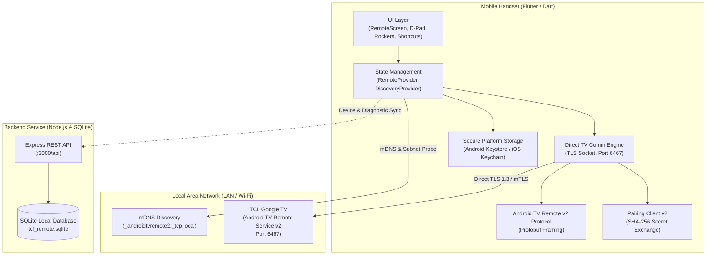

# Architecture Specification: TCL SMART REMOTE

## 1. System Overview

**TCL SMART REMOTE** is an enterprise-grade, cross-platform remote control application designed for TCL televisions running Google TV and compatible Android TV software.

The system is designed with a **Local-First, Zero-Cloud-Intermediary** architecture. The mobile handset speaks directly to the television over encrypted TLS sockets across the local home Wi-Fi network. The backend REST service acts as an administrative device registry, remote preferences coordinator, and diagnostic store without ever intercepting real-time remote commands.

---

## 2. Component Architecture

### 2.1 Mobile Application (`mobile/`)
Built using Flutter and Dart with pure native platform channels where appropriate:
- **Presentation Layer**: Custom reactive widgets adhering to TCL's signature design language (charcoal `#0F1015`, slate `#181A20`, and TCL crimson red `#E50914`).
- **State Management**: `provider` pattern decoupling hardware socket states from UI widgets.
- **TV Communication Engine (`mobile/lib/tv/`)**:
  - `protocol/android_tv_v2.dart`: Full wire-level Protobuf encoder and decoder implementing the Google TV Remote Service v2 packet format.
  - `protocol/pairing_v2.dart`: High-security pairing wire framer utilizing mutual TLS and cryptographic challenge hashing.
  - `connection/tv_connection.dart`: Long-lived TLS socket manager handling bidirectional ping/pong keepalives, heartbeat monitoring, and exponential backoff reconnection.
  - `commands/tv_command_runner.dart`: Command pipeline translating button taps and swipes into `RemoteKeyInject` packets with key-down, key-up, and click durations.
  - `discovery/mdns_discovery.dart`: Multicast DNS scanner listening on `224.0.0.251:5353` for `_androidtvremote2._tcp.local` and `_androidtvremote._tcp.local`, accompanied by directed TCP subnet probing on port 6467.
  - `discovery/wol_service.dart`: UDP broadcast Wake-on-LAN magic packet generator targeting ports 9 and 7.

### 2.2 Backend Service (`backend/`)
Built with Node.js and Express.js with a modular SQLite persistence layer:
- **REST Endpoints**: Device synchronization, system settings persistence, diagnostic log ingestion, and health monitoring.
- **SQLite Database**: Structured relational schemas for `devices`, `app_settings`, `remote_preferences`, `app_shortcuts`, `connection_history`, and `diagnostics`.
- **Security Middleware**: Rate limiting (`express-rate-limit`), security headers (`helmet`), strict CORS filtering, and parameterized SQL queries preventing injection.

---

## 3. Communication Protocols

| Protocol Stage | Network Layer | Target Port | Wire Protocol | Encryption / Auth |
| :--- | :--- | :--- | :--- | :--- |
| **Discovery** | UDP (Multicast) | 5353 | mDNS / DNS-SD | Plaintext LAN |
| **Fallback Scan**| TCP (Unicast) | 6467 | TCP SYN probe | N/A |
| **Pairing** | TCP / TLS | 6467 (v2) / 6466 | Protobuf v2 / Hex PIN | TLS 1.2 / 1.3 + SHA-256 Secret |
| **Remote Control** | TCP / TLS | 6467 | Protobuf v2 Framing | Mutual TLS (Client Cert Whitelist) |
| **Wake-on-LAN** | UDP (Broadcast) | 9 / 7 | Magic Packet (102 B) | Ethernet MAC Broadcast |
| **Backend REST** | HTTP / JSON | 3000 | RESTful JSON API | Local Network / Bearer / CORS |

---

## 4. Key Design Decisions

1. **Direct Phone-to-TV Communication**: The mobile device opens a direct socket to the TV. Even if the internet connection is severed or the backend service is halted, the remote continues functioning seamlessly as long as the local router routes LAN traffic.
2. **Zero Plaintext Secrets**: Client private keys and certificates are generated using 2048-bit RSA on the smartphone and stored within Android Keystore or iOS Keychain via `flutter_secure_storage`.
3. **No Protocol Inventions**: Implements the official Android TV Remote Service v2 wire protocol.
